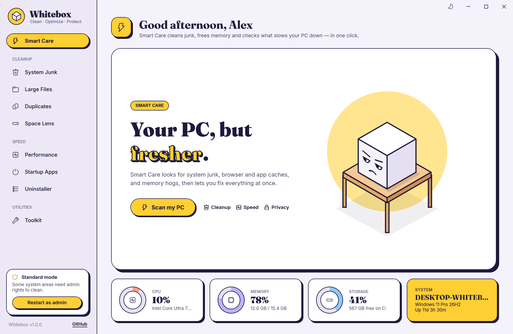
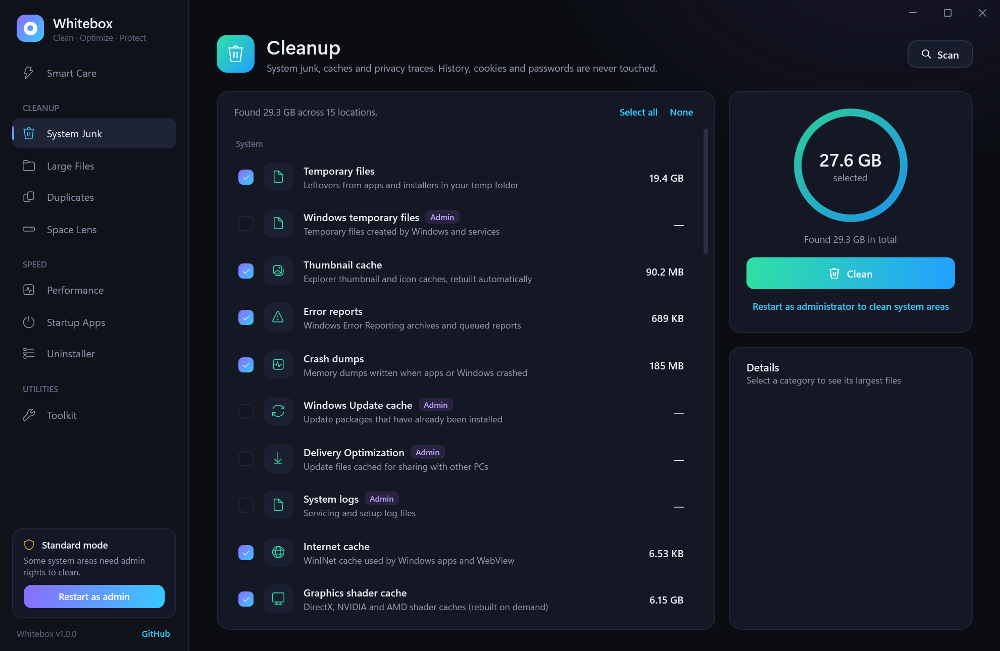
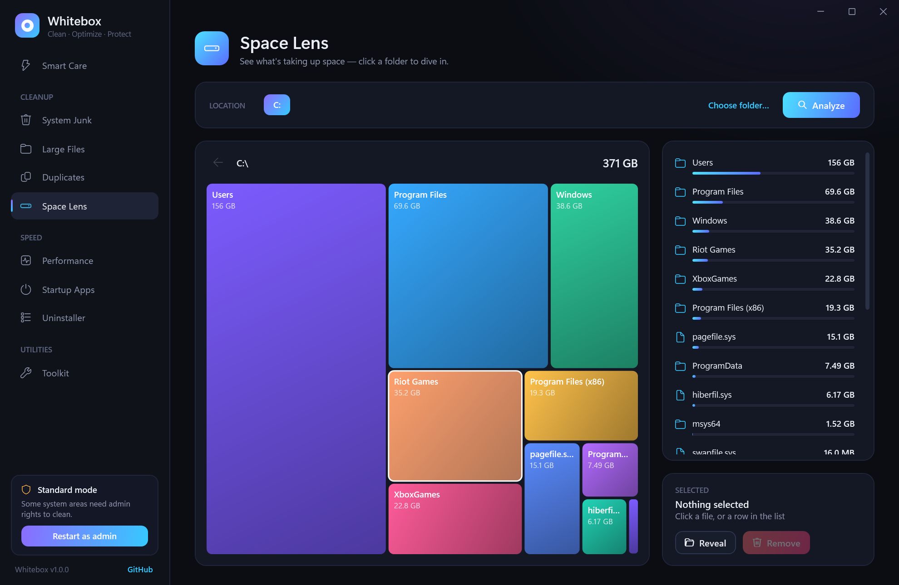
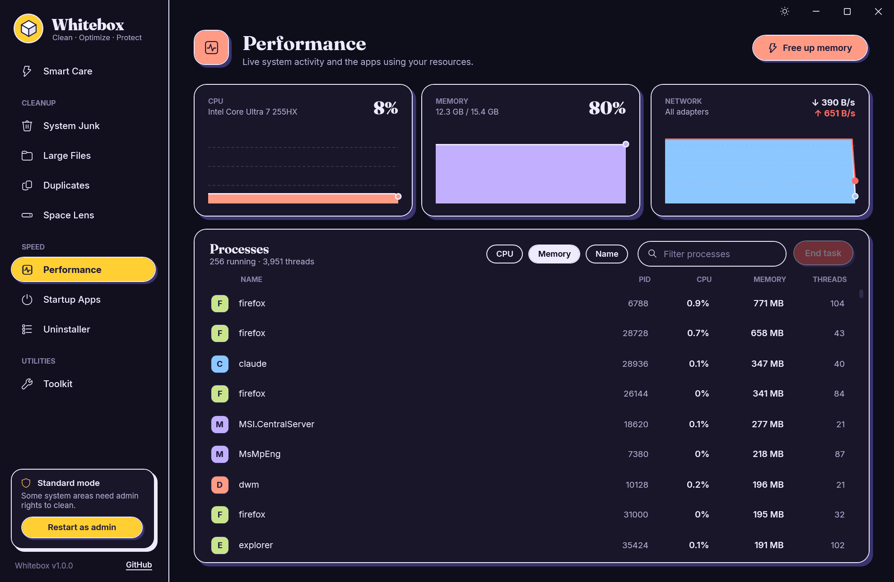
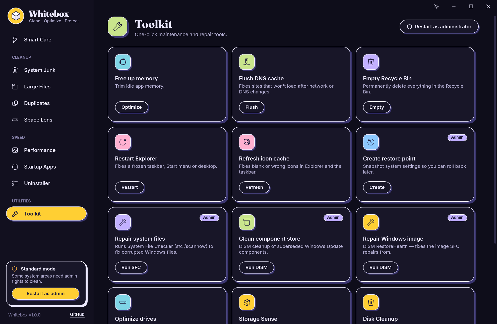
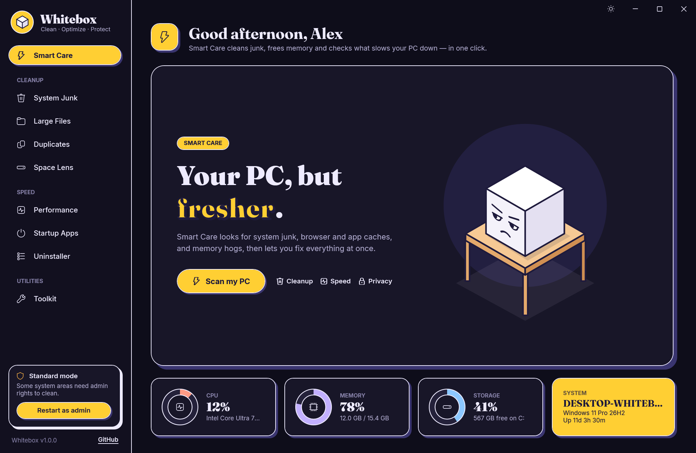

<div align="center">


# Whitebox

**A free, open-source cleaner and performance toolkit for Windows.**
Clean junk, find what's eating your disk, tame startup apps and keep an eye on your PC — in one fast, native app.

[](https://github.com/yi00it/whitebox/actions/workflows/ci.yml)
[](https://github.com/yi00it/whitebox/releases/latest)
[](LICENSE)


[**⬇ Download the latest version**](https://github.com/yi00it/whitebox/releases/latest)



</div>

## Status

**Current version: 1.0.0** — runs on Windows 10 and 11 (x64).

Highlights:

- **Bold, friendly design** with crisp "printed card" surfaces and bundled Fraunces + Inter typefaces.
- **Light and dark mode** — follows your Windows app theme on first run; flip it any time with the sun/moon button in the title bar. Your choice is remembered.
- **Smart Care home** with live CPU, memory, storage and system tiles.
- **Installer with automatic updates** — Whitebox checks for a new version once a day and updates in one click.

Every feature listed below is implemented. Builds are not code-signed yet (see the SmartScreen note under Download).

## Features

| | |
|---|---|
| **Smart Care** | One click to scan, then clean junk and free up memory. Live CPU, memory, disk and system tiles. |
| **System Junk** | ~30 locations: temp files, Windows Update and Delivery Optimization caches, error reports, crash dumps, shader caches, Recycle Bin, browser caches (Chrome, Edge, Brave, Vivaldi, Opera, Firefox), app caches (Discord, VS Code, Slack, Teams, Spotify, Steam), developer caches (npm, Yarn, pip, NuGet) and privacy traces. |
| **Large Files** | Scans a whole drive in parallel; filter by videos, disk images, installers, archives… |
| **Duplicates** | Finds byte-for-byte identical files, verified with SHA-256. Auto-select keeps the oldest copy. |
| **Space Lens** | Interactive map of your drive — every folder sized by the space it takes. Click to dive in. |
| **Performance** | Live CPU, memory and network charts, process list, end task, free up memory. |
| **Startup Apps** | Turn apps that launch at sign-in on or off (the same switch Task Manager uses). |
| **Uninstaller** | Every installed app with icon, size and date; removes leftover folders afterwards. |
| **Toolkit** | Flush DNS, empty Recycle Bin, restart Explorer, refresh icon cache, create a restore point, SFC, DISM, power plans. |

<table>
<tr>
<td></td>
<td></td>
</tr>
<tr>
<td></td>
<td></td>
</tr>
<tr>
<td colspan="2" align="center"></td>
</tr>
</table>

## Download & install

1. Go to the [latest release](https://github.com/yi00it/whitebox/releases/latest).
2. Download **`Whitebox-x.y.z-win-x64-setup.exe`**.
3. Run it. Whitebox installs for your account (no admin rights needed), adds itself to the Start menu and shows up in **Settings → Apps → Installed apps**, where you can uninstall it.

It runs on any 64-bit Windows 10 or 11 PC; nothing else needs to be installed.

> **"Windows protected your PC"?** Whitebox isn't code-signed yet, so SmartScreen warns about new downloads.
> Click **More info → Run anyway**. You can check the file with the `SHA256SUMS.txt` published with every release,
> or build it yourself from source (below).

### Updates

Whitebox checks GitHub for a new version once a day. When one is out, an **Update available** card appears in the sidebar:

- **Update** downloads the new installer, verifies it against the release's `SHA256SUMS.txt`, installs it and reopens Whitebox. It takes a few seconds.
- **Later** hides the card until the next day's check.

Nothing is installed without your OK.

Whitebox runs without admin rights. A few system areas (Windows Update cache, system logs, all-users startup items) are marked **Admin**; use **Restart as admin** in the sidebar to unlock them.

## Is it safe?

Whitebox is built to be conservative:

- Browser **history, cookies and saved passwords are never touched** — only caches that browsers rebuild themselves.
- Temp files changed in the last 2 hours are left alone, so running installers don't break.
- Files that are in use are skipped. An app's cache is skipped entirely while that app is running.
- Large files, duplicates and Space Lens items go to the **Recycle Bin**, so you can restore them.
- Every action that removes something asks you to confirm first.
- No telemetry, no accounts. Everything runs locally. The only network call is the daily update check, which asks GitHub for the latest release and sends nothing about you or your PC.

Whitebox is provided as-is under the MIT license, with no warranty. Review what's selected before you clean.

## Build from source

Requires the [.NET 10 SDK](https://dotnet.microsoft.com/download/dotnet/10.0).

```powershell
git clone https://github.com/yi00it/whitebox.git
cd whitebox
dotnet run
```

Release build: the installer, the same file that's published on GitHub (needs [Inno Setup 6](https://jrsoftware.org/isinfo.php), e.g. `winget install JRSoftware.InnoSetup`):

```powershell
.\installer\build.ps1
```

This writes `dist\Whitebox-x.y.z-win-x64-setup.exe`. Pushing a `v*` tag builds it on GitHub Actions and publishes it as a release, which installed copies then pick up as an update.

### Project layout

```
Core/        MVVM helpers, converters, formatting, P/Invoke, ThemeManager (light/dark)
Controls/    RingGauge, Sparkline, TreeMap, Spinner, PageHeader, Surface, OutlineText (custom-drawn)
Services/    JunkEngine, FileScanner, SpaceAnalyzer, ProcessService, StartupService, AppsService, SystemMonitor, UpdateService
ViewModels/  One per page
Views/       XAML pages
Themes/      Light.xaml / Dark.xaml palettes; Theme.xaml: gradients and all control styles
Assets/      App icon and bundled fonts (Fraunces, Inter — SIL Open Font License)
```

### Developer switches

```
Whitebox.exe --page <home|cleanup|large|dupes|space|performance|startup|apps|tools> [--scan <ms>] [--demo] [--theme light|dark] --shot out.png
```

Opens a page, optionally runs its scan, renders the window to a PNG and exits. `--demo` swaps in placeholder user and machine names and `--theme` forces a palette, which is how the screenshots above are made.

## Contributing

Bug reports, ideas and pull requests are welcome. See [CONTRIBUTING.md](CONTRIBUTING.md), and please follow the [Code of Conduct](CODE_OF_CONDUCT.md).

## License

[MIT](LICENSE) © 2026 Yigit Ozdamar

Bundled fonts [Fraunces](Assets/Fonts/Fraunces-OFL.txt) and [Inter](Assets/Fonts/Inter-OFL.txt) are licensed under the SIL Open Font License 1.1.
